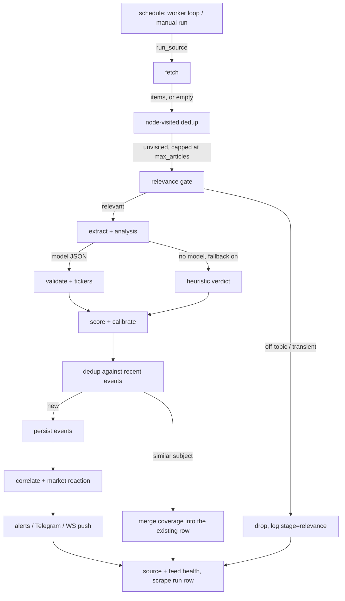

# The ingest state machine

One source cycle, from a scheduled tick to a row the dashboard can serve. Every stage
names where it lives, what it writes, and what happens when it fails — the failure path
is part of the contract, not an afterthought. `docs/INGEST.md` is checked by
`tests/test_ingest_doc.py`: every stage below must appear, and the diagram must be
reachable from the README.

## Stages, owners, and the failure path

| # | Stage | Code | Writes | On failure |
|---|---|---|---|---|
| 1 | **fetch** | `worker/runner.py` `run_source` → `finscrape/scrapers` | nothing | `record_source_health(..., "WARN", error)`, `finish_scrape_run(..., "failed")`, cycle returns zeros; retries/backoff and the circuit breaker live in the scraper layer |
| 2 | **visited dedup** | `worker/runner.unvisited` | nothing | a DB error aborts the cycle and is recorded as a failed run; no rows are marked visited |
| 3 | **relevance gate** | `finscrape/pipeline.is_market_relevant` | nothing | the article is dropped with `stage=relevance` at debug level; it is not marked visited, so a gate change can pick it up next cycle |
| 4 | **analysis** | `finscrape/analysis/ai_client` (+ council), or `fallback` when `FINSCRAPE_HEURISTIC_FALLBACK` is on | nothing | without fallback the article is dropped (`stage=analysis`); with fallback it lands with `analysis_source=heuristic`. One failed article never fails its batch — the pool isolates it |
| 5 | **validate + tickers** | `finscrape/analysis/validator`, `entity_map` | nothing | no grounded symbol → dropped (`stage=tickers`); nothing is invented |
| 6 | **score** | `validator.calculate_heuristic_score`, `calibrate_signal_score` | nothing | a scoring error fails that article only; the rest of the cycle continues |
| 7 | **dedup** | `finscrape/pipeline._find_duplicate` | `events.articles`/`events.sources` via `update_event` | a failed merge leaves the article un-persisted and unvisited, so the next cycle retries it |
| 8 | **persist** | `server/ingest.ingest_events` | `events` (transactional, content-hash unique) | a duplicate hash counts as a duplicate, not an error; any other error rolls the batch back and is recorded as a failed run |
| 9 | **correlate** | `worker/runner.run_correlations` | `correlations` | correlation is best-effort after the commit: a failure is logged and the events stay served |
| 10 | **notify** | `finscrape/alerts`, `worker/telegram_summary`, `server/ws.publish` | alert history, Telegram, WS frames | a notifier failure never rolls back an ingest (it runs from `background`/after the commit) |
| 11 | **health** | `record_source_health`, `record_feed_health`, `finish_scrape_run` | `source_health`, `feed_health`, `scrape_runs` | health writes are the last step; a failure is logged and `source_health` keeps its previous value |

## Invariants the tests pin

- **Idempotence**: the same payload twice inserts once (`tests/server/test_db_integration.py`).
- **Date ↔ feed agreement**: one UTC day-bounds convention, so the calendar count equals
  the feed count (`tests/server/test_db_integration.py`).
- **One model call per article**: `tests/test_one_llm_call.py`, and the council is off by
  default (404 without it).
- **A failed article is not judged**: `tests/test_worker_parallel.py`, so the next cycle
  retries it instead of recording a visit for a row that never landed.
- **A cycle's log lines share one `correlation_id`**: `finscrape/logging_config.py` sets it
  per cycle in `Worker.run_source`.

## Running one stage in isolation

| Goal | Command |
|---|---|
| every source once, real network | `python -m worker.main --once` |
| one stored event, model only | `python -m worker.analyze_event <event id>` (needs the DB) |
| a scraper only, no DB | `python -c "from worker.sources import SOURCES; print(len(SOURCES()))"` |
| the pipeline only | `pytest -q tests/test_pipeline.py` |
| the DB stages only | `pytest -q tests/server/test_db_integration.py` (needs `WORLDFIN_TEST_DATABASE_URL`) |
